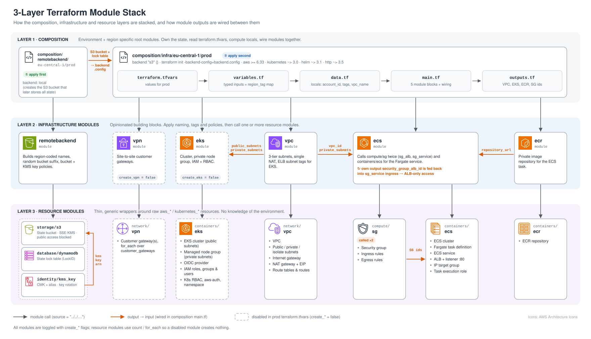
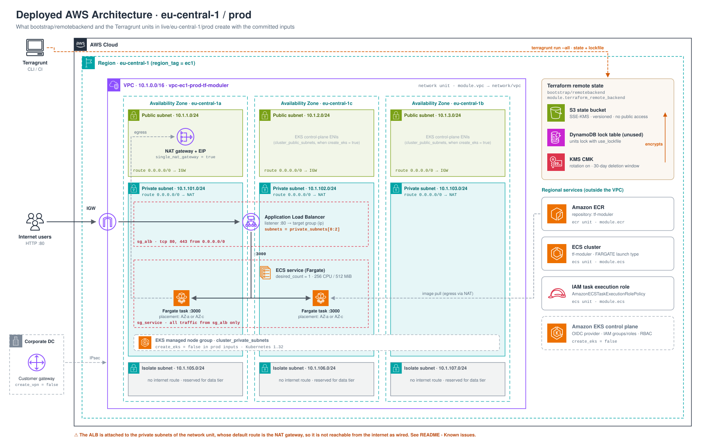

# 3-Layer AWS Terraform Modules

A Terraform codebase for AWS container platforms, split into three layers:

1. **Composition**: one root module per environment and region. It owns the state and the `terraform.tfvars`.
2. **Infrastructure modules**: opinionated building blocks (VPC, ECS, EKS…) that apply naming, tagging and policy.
3. **Resource modules**: thin, generic wrappers around raw `aws_*` / `kubernetes_*` resources.

Each layer calls only the layer directly below it. To add an environment or region you add a new composition folder. Modules are not copied.

---

## Table of contents

- [Architecture](#architecture)
  - [Module stack](#module-stack)
  - [Deployed AWS architecture](#deployed-aws-architecture)
- [Repository layout](#repository-layout)
- [The three layers](#the-three-layers)
- [Module catalogue](#module-catalogue)
- [How the modules are wired together](#how-the-modules-are-wired-together)
- [Naming and tagging](#naming-and-tagging)
- [Feature flags](#feature-flags)
- [Prerequisites](#prerequisites)
- [Deployment](#deployment)
- [Outputs](#outputs)
- [Extending the codebase](#extending-the-codebase)
- [CI/CD](#cicd)
- [Known issues](#known-issues)

---

## Architecture

### Module stack

How the layers stack, which module calls which, and how module outputs are fed into other modules' inputs.



- **Grey arrows** are module calls (`source = "../../…"`).
- **Orange arrows** are values passed from one module's outputs into another module's inputs. All of this wiring happens in `composition/infra/eu-central-1/prod/main.tf`. Infrastructure modules never reference each other directly.
- **Dashed boxes** are modules that exist but are switched off in the committed prod `terraform.tfvars`.

### Deployed AWS architecture

What the two compositions create in `eu-central-1` with the committed `terraform.tfvars`.



---

## Repository layout

```text
.
├── composition/                          # LAYER 1: root modules (one per stack / region / env)
│   ├── remotebackend/eu-central-1/prod/  #   ① bootstrap: S3 + DynamoDB + KMS for remote state (local state)
│   └── infra/eu-central-1/prod/          #   ② workload: VPC, VPN, EKS, ECR, ECS (S3 remote state)
│       ├── providers.tf                  #     terraform + provider requirements, backend "s3" {}
│       ├── variables.tf                  #     typed inputs, region_tag map
│       ├── terraform.tfvars              #     prod values
│       ├── data.tf                       #     aws_caller_identity + locals (tags, vpc_name, vpc_tags)
│       ├── main.tf                       #     module calls + cross-module wiring
│       └── outputs.tf
│
├── infrastructure_modules/               # LAYER 2: opinionated building blocks
│   ├── remotebackend/                    #   s3 + dynamodb + kms_key, bucket & key policies
│   ├── vpc/                              #   network/vpc + EKS subnet tags
│   ├── vpn/                              #   network/vpn
│   ├── eks/                              #   containers/eks
│   ├── ecr/                              #   containers/ecr
│   └── ecs/                              #   compute/sg (×2) + containers/ecs
│
├── resource_modules/                     # LAYER 3: generic resource wrappers
│   ├── compute/sg/
│   ├── containers/{ecr,ecs,eks}/
│   ├── database/dynamodb/
│   ├── identity/kms_key/
│   ├── network/{vpc,vpn}/
│   └── storage/s3/
│
├── docs/
│   ├── images/                           # architecture diagrams (SVG, rendered in this README)
│   └── diagrams/                         # editable draw.io sources of the same diagrams
└── .github/workflows/main.yml            # Terraform GitHub Actions pipeline (currently commented out)
```

---

## The three layers

| Layer | Path | Responsibility | Knows about the environment? |
|---|---|---|---|
| **1 · Composition** | `composition/<stack>/<region>/<env>/` | Holds the state and backend config. Reads `terraform.tfvars`, computes `locals`, calls infrastructure modules and passes outputs between them. | Yes. This is the only layer with real values. |
| **2 · Infrastructure** | `infrastructure_modules/<name>/` | Bundles resource modules into a usable unit. Adds naming conventions, tags, IAM/KMS policies and Kubernetes subnet tags. | Partly. Receives `env`, `app_name`, `region` and `tags` as inputs. |
| **3 · Resource** | `resource_modules/<category>/<name>/` | Wraps raw provider resources. Every resource has a `create_*` toggle via `count` / `for_each`. | No. Fully generic. |

Rules the layout enforces:

- A composition calls **only** infrastructure modules. An infrastructure module calls **only** resource modules.
- Modules never read each other's outputs directly. Values flow up to the composition and back down (see [wiring](#how-the-modules-are-wired-together)).
- All module sources are relative paths, so the repo has no registry dependency.

---

## Module catalogue

### Infrastructure modules (layer 2)

| Module | Calls | What it adds | Key outputs |
|---|---|---|---|
| `remotebackend` | `storage/s3`, `database/dynamodb`, `identity/kms_key` | Region-coded names, a `random_integer` bucket suffix, an S3 bucket policy and a KMS key policy. Encrypts the bucket with the new CMK. | `s3_id`, `s3_arn`, `dynamodb_id`, `dynamodb_arn`, `s3_kms_arn`, `s3_kms_alias_arn`, `s3_kms_id` |
| `vpc` | `network/vpc` | Subnet tags `Tier` and `kubernetes.io/role/(internal-)elb`, plus `kubernetes.io/cluster/<cluster_name> = shared` so EKS load balancers can find subnets. | `vpc_id`, `vpc_cidr_block`, `public_subnets`, `private_subnets`, `isolate_subnets` (+ `*_cidr_blocks`) |
| `vpn` | `network/vpn` | Pass-through for customer gateways. | `customer_gateway_ids` |
| `eks` | `containers/eks` | Pass-through for cluster settings. | `cluster_id`, `cluster_arn`, `cluster_endpoint`, `cluster_version` |
| `ecr` | `containers/ecr` | Pass-through for the repository. | `ecr_repository_url` |
| `ecs` | `compute/sg` **twice** (`sg_alb`, `sg_service`), `containers/ecs` | An ALB security group, a service security group, and the Fargate service behind an ALB. | `security_group_alb_id`, `service_security_group_id` |

### Resource modules (layer 3)

| Module | Resources |
|---|---|
| `network/vpc` | `aws_vpc`, public / private / isolate `aws_subnet`, `aws_internet_gateway`, `aws_nat_gateway` + `aws_eip`, route tables, routes and associations |
| `network/vpn` | `aws_customer_gateway` (`for_each` over `customer_gateways`) |
| `compute/sg` | `aws_security_group`, ingress and egress `aws_security_group_rule` |
| `containers/ecr` | `aws_ecr_repository` |
| `containers/ecs` | `aws_ecs_cluster`, `aws_ecs_task_definition` (Fargate, 256 CPU / 512 MiB), `aws_ecs_service`, `aws_alb`, `aws_lb_listener` (:80), `aws_lb_target_group` (ip), task execution `aws_iam_role` |
| `containers/eks` | `aws_eks_cluster`, private `aws_eks_node_group`, `aws_iam_openid_connect_provider`, IAM roles / groups / users (admin, developer, read-only), `kubernetes_config_map_v1` (aws-auth), cluster roles / bindings, a namespace, and its own `kubernetes` provider |
| `storage/s3` | `aws_s3_bucket`, ACL, ownership controls, bucket policy, public access block, SSE configuration, CORS, accelerate |
| `database/dynamodb` | `aws_dynamodb_table` |
| `identity/kms_key` | `aws_kms_key`, `aws_kms_alias` |

---

## How the modules are wired together

All cross-module values are passed in `composition/infra/eu-central-1/prod/main.tf`:

| From | Output | To | Input | Why |
|---|---|---|---|---|
| `module.vpc` | `public_subnets` | `module.eks` | `cluster_public_subnets` | Subnets for the EKS control-plane ENIs |
| `module.vpc` | `private_subnets` | `module.eks` | `cluster_private_subnets` | Subnets for the managed node group |
| `module.vpc` | `vpc_id` | `module.ecs` | `vpc_id` | Security groups and target group |
| `module.vpc` | `private_subnets` | `module.ecs` | `subnets` | ALB and Fargate task ENIs (see [Known issues](#known-issues)) |
| `module.ecr` | `ecr_repository_url` | `module.ecs` | `ecr_repo_url` | Container image for the task definition |
| `module.ecs` | `security_group_alb_id` | `module.ecs` | `sg_service_ingress_rules[0].source_security_group_id`, `alb_seurity_group_id` | ALB-only ingress to the service |
| `module.ecs` | `service_security_group_id` | `module.ecs` | `service_security_group_id` | Attaches the SG to the ECS service |
| `data.aws_caller_identity` | `account_id` | `module.eks` | `account_id` | IAM ARNs in the EKS module |
| `local.vpc_tags` / `local.tags` | n/a | every module | `tags` | Consistent tagging |

**ECS self-reference.** The `ecs` module receives one of its own outputs (`security_group_alb_id`) as an input. This works because Terraform resolves dependencies per resource, not per module. `sg_alb` is created first. Its ID is then used for the `sg_service` ingress rule and the ALB. As a result, the service only accepts traffic from the load balancer. The ID can't come from `.tfvars` because it doesn't exist until apply time.

**Cross-stack wiring.** The two compositions are not linked by `terraform_remote_state`. The remote backend's outputs (bucket name, lock table) go into a local `backend.config` file used when initialising `composition/infra`.

---

## Naming and tagging

`composition/infra/eu-central-1/prod/data.tf`:

```hcl
locals {
  account_id = data.aws_caller_identity.current.account_id

  tags = {
    Environment = var.env       # prod
    Application = var.app_name  # tf-moduler
    Terraform   = true
  }

  vpc_name = "vpc-${var.region_tag[var.region]}-${var.env}-${var.app_name}"  # vpc-ec1-prod-tf-moduler
  vpc_tags = merge(local.tags, tomap({ "VPC-Name" = local.vpc_name }))
}
```

`region_tag` (in `variables.tf`) maps regions to short codes: `us-east-1 → ue1`, `us-west-1 → uw1`, `eu-west-1 → ew1`, `eu-central-1 → ec1`, `ap-northeast-1 → apne1`. Add an entry here before deploying to a new region.

The remote backend builds its names the same way:

| Resource | Pattern |
|---|---|
| S3 bucket | `s3-<region_tag>-<app_name>-<env>-terraform-backend-<1..100>` |
| DynamoDB table | `dynamo-<region_tag>-<app_name>-<env>-terraform-state-lock` |
| KMS alias | `alias/cmk-<region_tag>-<env>-s3-terraform-backend` |

---

## Feature flags

Every module can be switched on or off from `terraform.tfvars`. Disabled modules create no resources.

| Flag | Prod value | Effect |
|---|---|---|
| `create_vpc` | `true` | VPC, 9 subnets (3 × public / private / isolate), IGW, single NAT gateway |
| `create_vpn` / `create_customer_gateway` | `false` / `false` | Customer gateways from `customer_gateways` (both must be `true`) |
| `create_eks` | `false` | EKS 1.32 cluster, node group, OIDC, IAM and RBAC |
| `create_ecr` | `true` | ECR repository `tf-moduler` |
| `create_sg` | `true` | ALB and service security groups |
| `create_ecs` | `true` | ECS cluster, task definition, service, ALB, target group |

Network values for prod:

| Tier | CIDRs (AZ a / c / b) | Default route |
|---|---|---|
| VPC | `10.1.0.0/16` | n/a |
| Public | `10.1.1.0/24`, `10.1.2.0/24`, `10.1.3.0/24` | Internet gateway |
| Private | `10.1.101.0/24`, `10.1.102.0/24`, `10.1.103.0/24` | Single NAT gateway (AZ a) |
| Isolate | `10.1.105.0/24`, `10.1.106.0/24`, `10.1.107.0/24` | None |

---

## Prerequisites

- **Terraform** `>= 1.0` (CI pins `1.11.0`)
- **AWS credentials** for the target account. Neither composition sets a provider `region`, so export it yourself:

  ```bash
  export AWS_PROFILE=default
  export AWS_REGION=eu-central-1
  ```

  The `region`, `role_name` and `profile_name` variables are used for naming only. They do not configure the provider.

- **Providers** (installed by `terraform init`):

  | Provider | Source | Version | Used by |
  |---|---|---|---|
  | aws | `hashicorp/aws` | `>= 6.33.0` | both compositions |
  | kubernetes | `hashicorp/kubernetes` | `~> 3.0.1` | `containers/eks` |
  | helm | `hashicorp/helm` | `~> 3.1.1` | declared in `composition/infra` |
  | http | `hashicorp/http` | `~> 3.5.0` | declared in `composition/infra` |
  | random | `hashicorp/random` | latest | `infrastructure_modules/remotebackend` |

---

## Deployment

The remote backend has to exist before the infra stack can store state in it. Deploy in this order:

### 1. Bootstrap the remote backend (local state)

```bash
cd composition/remotebackend/eu-central-1/prod
terraform init
terraform apply
terraform output   # note s3_terraform_remote_backend_id and dynamodb_terraform_state_lock_id
```

This stack keeps its own state in a local `terraform.tfstate` (git-ignored). Back that file up, or migrate it into the new bucket afterwards: uncomment `backend "s3" {}` and run `terraform init -migrate-state`.

### 2. Create `backend.config` for the infra stack

`composition/infra/eu-central-1/prod/backend.config` (git-ignored):

```hcl
bucket         = "<s3_terraform_remote_backend_id>"
key            = "infra/eu-central-1/prod/terraform.tfstate"
region         = "eu-central-1"
dynamodb_table = "<dynamodb_terraform_state_lock_id>"
encrypt        = true
```

> On Terraform ≥ 1.10 you can replace `dynamodb_table` with `use_lockfile = true` (S3-native locking). `dynamodb_table` still works but is deprecated.

### 3. Deploy the infrastructure

```bash
cd composition/infra/eu-central-1/prod
terraform init -backend-config=backend.config
terraform plan
terraform apply
```

### Tear down

Destroy in reverse order: `composition/infra` first, then `composition/remotebackend`. The state bucket has `force_destroy = false`, so empty it first.

---

## Outputs

### `composition/infra/eu-central-1/prod`

| Group | Outputs |
|---|---|
| VPC | `vpc_id`, `vpc_cidr_block`, `public_subnets`, `private_subnets`, `isolate_subnets`, `*_subnets_cidr_blocks` |
| VPN | `customer_gateway_ids` |
| EKS | `cluster_id`, `cluster_arn`, `cluster_endpoint`, `cluster_version` |
| ECR | `ecr_repository_url` |
| Security groups | `security_group_alb_id`, `service_security_group_id` |

### `composition/remotebackend/eu-central-1/prod`

| Group | Outputs |
|---|---|
| S3 | `s3_terraform_remote_backend_id`, `s3_terraform_remote_backend_arn` |
| DynamoDB | `dynamodb_terraform_state_lock_id`, `dynamodb_terraform_state_lock_arn` |
| KMS | `s3_kms_terraform_backend_arn`, `s3_kms_terraform_backend_alias_arn`, `s3_kms_terraform_backend_id` |

---

## Extending the codebase

**New environment or region.** Copy a composition folder and change only the values:

```bash
cp -r composition/infra/eu-central-1/prod composition/infra/eu-west-1/staging
# edit terraform.tfvars (region, env, CIDRs, azs …)
# use a new state key in backend.config, e.g. infra/eu-west-1/staging/terraform.tfstate
```

Make sure the region exists in the `region_tag` map.

**New AWS capability.** Build it bottom-up:

1. `resource_modules/<category>/<name>/`: raw resources behind a `create_*` flag, with no environment logic.
2. `infrastructure_modules/<name>/`: call the resource module(s) and add naming, tags and policies.
3. `composition/.../main.tf`: add a `module` block, pass outputs from other modules, and expose outputs.

---

## CI/CD

[.github/workflows/main.yml](.github/workflows/main.yml) contains a full pipeline, but it is **commented out**. Once enabled, it runs against `composition/infra/eu-central-1/prod`:

| Trigger | Steps |
|---|---|
| Pull request | `fmt -check` → `init` → `validate` → `plan`, then posts the plan as a PR comment |
| Push to `main` | `fmt -check` → `init` → `validate` → `apply -auto-approve` |

It authenticates through GitHub OIDC and needs these repository secrets: `AWS_ROLE`, `AWS_REGION`, `AWS_BUCKET_NAME`, `AWS_BUCKET_KEY_NAME`.

---

## Known issues

These come from reading the current code. Fix them before relying on the stack in production.

1. **The ALB is not reachable from the internet.** `module.ecs` gets `subnets = module.vpc.private_subnets`. `containers/ecs` uses that one list for both the ALB and the service. The ALB is internet-facing (no `internal` flag), but private subnets route `0.0.0.0/0` to the NAT gateway, not the IGW. Add a separate `alb_subnets` input fed from `module.vpc.public_subnets`. Also note that `assign_public_ip = true` on the service is pointless in private subnets: the public IP has no IGW route.
2. **The state bucket is not versioned.** `versioning_enabled` is passed to `infrastructure_modules/remotebackend`, but it is never forwarded to `storage/s3`, which has no `aws_s3_bucket_versioning` resource. Add one so state history survives overwrites.
3. **`eu-central-1` appears twice in the remote backend's `region_tag`.** In [infrastructure_modules/remotebackend/data.tf](infrastructure_modules/remotebackend/data.tf) it is mapped to both `ec1` and `euc1`. Terraform keeps the last one, so backend resources are named `…-euc1-…` while the infra stack uses `ec1`. Remove one entry. Changing it on a deployed backend renames, and so replaces, the bucket, table and KMS alias.
4. **Some variable names are misspelled.** `task_famliy` and `alb_seurity_group_id` are misspelled across all three layers. Renaming them is a breaking interface change, so do it in one pass.
5. **`containers/eks` declares its own `kubernetes` provider.** A module that configures a provider can't use `count` / `for_each` / `depends_on` and is awkward to remove. Consider moving the provider into the composition.
