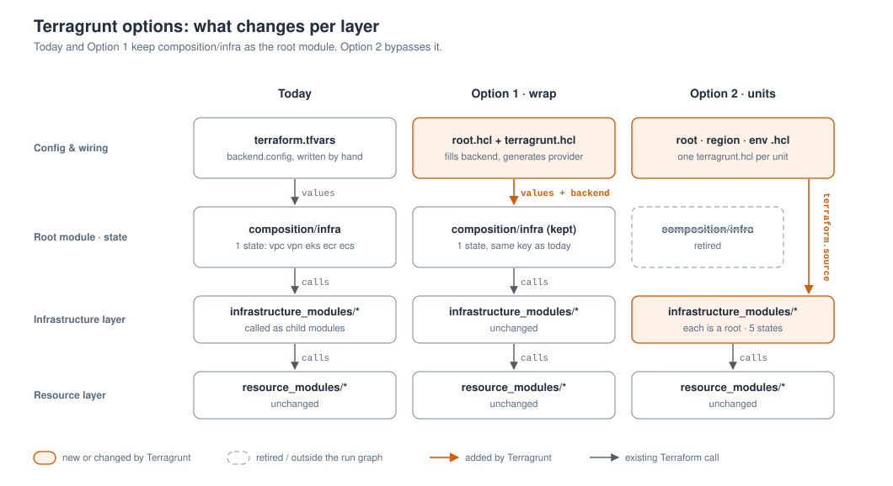
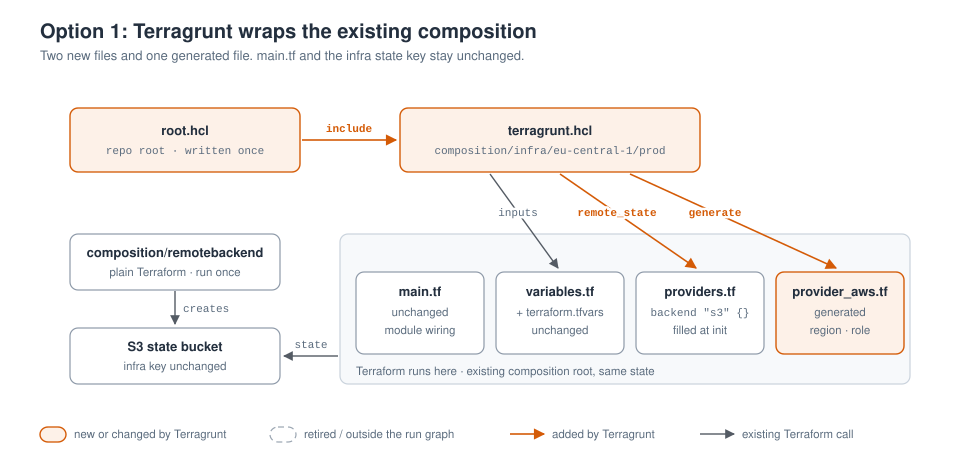
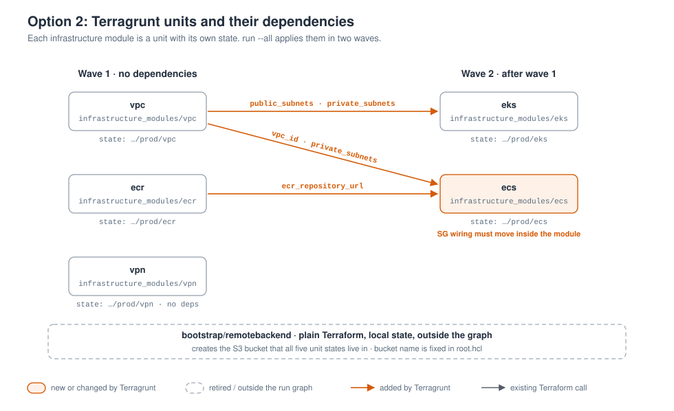
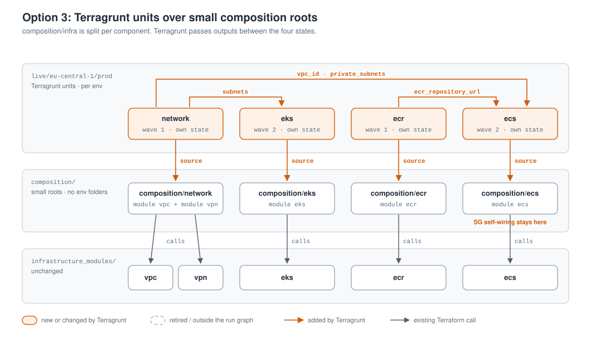

# Terragrunt architecture options

> **Status:** Option 3 is implemented. See `composition/` and `live/`.

How Terragrunt could sit on top of the existing composition → infrastructure → resource layers, if we adopt it.

There are three ways to do it:

- **Option 1: wrap the composition.** Keep `composition/`. Terragrunt fills in the backend, generates the AWS provider and runs the same root module. You keep the same state and the same Terraform code.
- **Option 2: Terragrunt units.** Retire `composition/infra`. Each infrastructure module becomes its own Terragrunt unit with its own state, and outputs move between units through `dependency` blocks.
- **Option 3: split the composition, then add Terragrunt units.** Break `composition/infra/main.tf` into small composition roots, one per component, with no environment folders. Each root becomes a Terragrunt unit with its own state.

**Short answer:** Terragrunt does not require removing the composition layer. Start with Option 1. When the infra state needs to be split, use Option 3 rather than Option 2. For whether we need Terragrunt at all, see [terragrunt-vs-composition.md](terragrunt-vs-composition.md).

---

## What each option changes



Option 1 only replaces the top row: `terraform.tfvars` and the hand-written `backend.config`. In Option 2 the arrow bypasses the composition layer, so every infrastructure module becomes a root module with its own state. Option 3 keeps all three layers and splits the composition layer into four small roots, one per state.

---

## Option 1: wrap the existing composition



Terragrunt runs inside `composition/infra/eu-central-1/prod`.

- **No `terraform.source`.** Terragrunt runs in place and doesn't copy the folder into `.terragrunt-cache`, so the `../../../../infrastructure_modules/…` paths still resolve.
- **The backend block stays.** `providers.tf` keeps its empty `backend "s3" {}`. Terragrunt's `remote_state` passes the values that `backend.config` holds today.
- **The provider is generated.** `generate "provider"` writes `provider_aws.tf` with the region (and assume-role settings), which fixes the missing region on the AWS provider.
- **The bootstrap stays plain Terraform.** `composition/remotebackend` creates the bucket the backend needs, so it can't use that backend itself.

### Layout

```text
3-layer-aws-tf-module/
├── root.hcl                  # NEW: remote_state + generate "provider"
├── composition/
│   ├── remotebackend/eu-central-1/prod/   # unchanged, plain Terraform, local state
│   └── infra/eu-central-1/prod/
│       ├── terragrunt.hcl    # NEW: include root.hcl
│       ├── main.tf  variables.tf  outputs.tf  data.tf   # unchanged
│       ├── providers.tf      # keep backend "s3" {}; drop the XXX_old alias
│       ├── terraform.tfvars  # unchanged
│       └── backend.config    # DELETE: replaced by root.hcl
├── infrastructure_modules/   # unchanged
└── resource_modules/         # unchanged
```

### What changes

- Backend values move from the git-ignored `backend.config` into the committed `root.hcl`.
- The AWS provider gets a real `region` instead of reading it from the shell.
- Run `terragrunt plan` / `terragrunt apply` in the folder instead of `terraform init -backend-config=backend.config`.
- No state migration. To undo, delete the two `.hcl` files.

### Watch for

- **Duplicate backend block.** Use `remote_state` *without* `generate`, or delete `backend "s3" {}` from `providers.tf`. Otherwise Terraform sees two backend blocks.
- **State key.** Set `key` to the value in today's `backend.config`. A key built with `path_relative_to_include()` would point at a new, empty state.

### Example (illustrative)

```hcl
# root.hcl
remote_state {
  backend = "s3"
  config = {
    bucket       = "s3-ec1-terraform-eks-demo-infra-prod-terraform-backend-<n>"
    key          = "<same key as backend.config>"
    region       = "eu-central-1"
    encrypt      = true
    use_lockfile = true # S3-native locking; or dynamodb_table = "dynamo-ec1-..."
  }
}

generate "provider" {
  path      = "provider_aws.tf"
  if_exists = "overwrite_terragrunt"
  contents  = <<EOF
provider "aws" {
  region = "eu-central-1"
}
EOF
}
```

```hcl
# composition/infra/eu-central-1/prod/terragrunt.hcl
include "root" {
  path = find_in_parent_folders("root.hcl")
}
# no terraform.source: runs in place; terraform.tfvars is still auto-loaded
```

---

## Option 2: Terragrunt units replace `composition/infra`



> If you are splitting the state, [Option 3](#option-3-split-the-composition-then-add-terragrunt-units) usually fits this repo better. It gives the same small states without the ECS refactor, and resource addresses don't change during the migration.

Each infrastructure module becomes a unit with its own state. The wiring that lives in `composition/infra/eu-central-1/prod/main.tf` today becomes `dependency` blocks:

| Unit | Depends on | Reads |
|---|---|---|
| `vpc` | none | |
| `ecr` | none | |
| `vpn` | none (it reads nothing from VPC today) | |
| `eks` | `vpc` | `public_subnets`, `private_subnets` |
| `ecs` | `vpc`, `ecr` | `vpc_id`, `private_subnets`, `ecr_repository_url` |

`terragrunt run --all apply` (`run-all` in older versions) applies the first three units in parallel, then `eks` and `ecs`. An apply on one unit can only affect that unit's resources.

### Layout

```text
3-layer-aws-tf-module/
├── bootstrap/remotebackend/eu-central-1/prod/   # was composition/remotebackend; plain Terraform
├── live/
│   ├── root.hcl              # remote_state (key per unit), generate provider + versions
│   ├── _envcommon/           # optional: shared defaults per module
│   │   └── vpc.hcl  eks.hcl  ecs.hcl  ecr.hcl  vpn.hcl
│   └── eu-central-1/
│       ├── region.hcl        # region, region_tag = "ec1"
│       └── prod/
│           ├── env.hcl       # env = "prod", app_name = "tf-moduler"
│           ├── vpc/terragrunt.hcl
│           ├── vpn/terragrunt.hcl
│           ├── ecr/terragrunt.hcl
│           ├── eks/terragrunt.hcl   # dependency "vpc"
│           └── ecs/terragrunt.hcl   # dependency "vpc", "ecr"
├── composition/infra/        # retired after migration
├── infrastructure_modules/   # each module is now a root; ecs needs a refactor
└── resource_modules/         # unchanged
```

Adding staging means copying `prod/` to `staging/` and editing `env.hcl`. Each unit file is a few lines.

### What changes

- **State.** The single infra state becomes five. Resource addresses lose one level (`module.vpc.module.x` becomes `module.x`), so every resource has to be moved or imported into its new state. This is the main cost of Option 2.
- **Locals.** The composition's `locals` (tags, `vpc_name`, `region_tag`, `account_id`) move into `root.hcl`, `region.hcl` and `env.hcl`. `get_aws_account_id()` replaces the `aws_caller_identity` lookup.
- **Apply.** Run `terragrunt run --all apply` from `live/`, or apply a single unit from its folder.

### Code that has to change

- **ECS self-references.** `main.tf` passes `module.ecs.security_group_alb_id` and `module.ecs.service_security_group_id` back into `module.ecs`. A unit can't read its own outputs, so this wiring has to move inside `infrastructure_modules/ecs` before the split.
- **Providers and versions.** The infrastructure modules declare only `required_version`. `root.hcl` has to generate `required_providers` (aws, kubernetes) as well as the provider block.

### Example (illustrative)

```hcl
# live/eu-central-1/prod/ecs/terragrunt.hcl
include "root" {
  path = find_in_parent_folders("root.hcl")
}

terraform {
  source = "${get_repo_root()}//infrastructure_modules/ecs"
}

dependency "vpc" { config_path = "../vpc" }
dependency "ecr" { config_path = "../ecr" }

inputs = {
  vpc_id       = dependency.vpc.outputs.vpc_id
  subnets      = dependency.vpc.outputs.private_subnets
  ecr_repo_url = dependency.ecr.outputs.ecr_repository_url
  # alb / service SG ids are no longer inputs: wired inside the module
}
```

The `//` in `source` tells Terragrunt to copy the whole repo into the cache, so the module's relative paths to `resource_modules/` still work.

---

## Option 3: split the composition, then add Terragrunt units



`composition/infra/main.tf` is broken into four small composition roots, one per component. Each root is a Terragrunt unit with its own state. Terragrunt supplies the per-environment values, the backend and the order. The composition roots keep the naming, tags and glue code, so all three layers stay as the [README](../README.md) describes them.

### Layout

```text
3-layer-aws-tf-module/
├── bootstrap/remotebackend/eu-central-1/prod/   # was composition/remotebackend; plain Terraform
├── composition/              # small roots, NO region/env folders
│   ├── network/              # module "vpc" + module "vpn"
│   │   └── main.tf  variables.tf  outputs.tf  data.tf
│   ├── ecr/                  # module "ecr"
│   ├── eks/                  # module "eks"
│   └── ecs/                  # module "ecs", keeps the security-group self-wiring
├── live/
│   ├── root.hcl              # remote_state (key per unit), generate provider
│   └── eu-central-1/
│       ├── region.hcl        # region, region_tag = "ec1"
│       └── prod/
│           ├── env.hcl       # env = "prod", app_name = "tf-moduler"
│           ├── network/terragrunt.hcl   # source = composition/network
│           ├── ecr/terragrunt.hcl
│           ├── eks/terragrunt.hcl       # dependency "network"
│           └── ecs/terragrunt.hcl       # dependency "network", "ecr"
├── infrastructure_modules/   # unchanged
└── resource_modules/         # unchanged
```

**Design rule: keep region and environment out of the composition paths.** If the split produces `composition/network/eu-central-1/prod/`, `composition/eks/eu-central-1/prod/` and so on, every new environment copies four folders of `.tf` files. That is the duplication problem from [terragrunt-vs-composition.md](terragrunt-vs-composition.md), made worse. Keep `composition/<component>/` the same for every environment, and put per-environment values in `live/` as Terragrunt `inputs`.

### Units and wiring

| Unit | Composition root | Depends on | Reads |
|---|---|---|---|
| `network` | `composition/network` (vpc + vpn) | none | |
| `ecr` | `composition/ecr` | none | |
| `eks` | `composition/eks` | `network` | `public_subnets`, `private_subnets` |
| `ecs` | `composition/ecs` | `network`, `ecr` | `vpc_id`, `private_subnets`, `ecr_repository_url` |

Four states rather than five. VPN reads nothing from VPC today but belongs to the network tier, so it shares the `network` state. ECR stays separate from ECS so that images survive an ECS teardown. `composition/infra/outputs.tf` is already grouped by module, so it splits cleanly into each root's `outputs.tf`.

### Why Option 3 over Option 2

1. **No ECS refactor.** The `module.ecs.security_group_alb_id` → `module.ecs` self-wiring stays in `composition/ecs/main.tf`. Option 2 has to move it inside `infrastructure_modules/ecs` first.
2. **Simpler state migration.** Each root keeps the same module block name (`module "vpc"`, `module "ecs"`), so resource addresses stay the same in the new states. In Option 2 every address loses a level.
3. **Three layers stay.** Naming, tags and glue code stay in Terraform. Terragrunt only supplies values, backends and ordering.
4. **Less lock-in.** The small roots are plain Terraform. Without Terragrunt they can be wired with `terraform_remote_state`.

### Costs and things to plan for

- **Variables declared twice.** Each root's `variables.tf` re-declares the inputs of the module it calls. This is today's `variables.tf` (about 240 lines), split across four files. Option 2 avoids it by sending inputs straight to the infrastructure module.
- **Relative paths change.** Module sources move from `../../../../infrastructure_modules/<name>` to `../../infrastructure_modules/<name>`. Use `source = "${get_repo_root()}//composition/<name>"` in the unit so the whole repo is copied into the cache and those paths resolve.
- **Plan on a new environment.** `run --all plan` fails for `eks` and `ecs` until `network` has been applied, because the outputs don't exist yet. Add `mock_outputs` to the `dependency` blocks, limited to `init`, `validate` and `plan`.
- **Disabled components.** `create_eks = false` today. The `eks` unit stays in `live/` because nothing depends on it, so it plans to nothing.
- **Upstream changes need ordered applies.** If the VPC subnets change, apply `network` first, then `eks` and `ecs`. `run --all apply` handles the order. A plan of `ecs` alone only sees outputs that are already applied.
- **Pick one wiring method and one provider source.** Use Terragrunt `dependency` blocks *or* `terraform_remote_state`, not both. Either generate the provider from `root.hcl` or keep a `providers.tf` in each root, not both.
- **Shared locals.** Tags, `vpc_name` and `account_id` are computed in today's `data.tf`. Pass them in from `root.hcl` / `env.hcl`, or repeat the small `data.tf` in each root that needs them.

### Migration outline

1. Create `composition/network`, `ecr`, `eks` and `ecs` from today's `main.tf`, `variables.tf`, `outputs.tf` and `data.tf`. Keep the module block names exactly as they are now.
2. Replace cross-module references with variables: `module.vpc.vpc_id` becomes `var.vpc_id`, and so on. Leave references inside one module, such as the ECS security groups, as they are.
3. Back up the current infra state. The state bucket is versioned (`versioning_enabled` creates `aws_s3_bucket_versioning`), but take an explicit `terraform state pull` copy as well.
4. For each unit, start from a copy of the old state in its new key, then `terraform state rm` the modules that unit does not own.
5. Run `terragrunt plan` in each unit. Every plan should show **no changes**. Check that each resource is owned by exactly one state.
6. Retire `composition/infra` and delete its old state key last.

### Example (illustrative)

```hcl
# live/eu-central-1/prod/ecs/terragrunt.hcl
include "root" {
  path = find_in_parent_folders("root.hcl")
}

terraform {
  source = "${get_repo_root()}//composition/ecs"
}

dependency "network" {
  config_path = "../network"
  mock_outputs = {
    vpc_id          = "vpc-00000000"
    private_subnets = ["subnet-00000000"]
  }
  mock_outputs_allowed_terraform_commands = ["init", "validate", "plan"]
}

dependency "ecr" {
  config_path = "../ecr"
  mock_outputs = {
    ecr_repository_url = "000000000000.dkr.ecr.eu-central-1.amazonaws.com/mock"
  }
  mock_outputs_allowed_terraform_commands = ["init", "validate", "plan"]
}

inputs = {
  vpc_id       = dependency.network.outputs.vpc_id
  subnets      = dependency.network.outputs.private_subnets
  ecr_repo_url = dependency.ecr.outputs.ecr_repository_url
}
```

```hcl
# composition/ecs/main.tf (excerpt)
module "ecs" {
  source = "../../infrastructure_modules/ecs"

  vpc_id       = var.vpc_id       # was module.vpc.vpc_id
  subnets      = var.subnets      # was module.vpc.private_subnets
  ecr_repo_url = var.ecr_repo_url # was module.ecr.ecr_repository_url

  # unchanged: wiring inside the same module stays in the composition
  alb_seurity_group_id      = module.ecs.security_group_alb_id
  service_security_group_id = module.ecs.service_security_group_id
  # ...
}
```

---

## Side by side

| | Today | Option 1 · wrap | Option 2 · units | Option 3 · split + units |
|---|---|---|---|---|
| Terraform states | 2: bootstrap + infra | 2, unchanged | bootstrap + 5 units | bootstrap + 4 units |
| Layers | 3 | 3 + Terragrunt | 2 + Terragrunt | 3 + Terragrunt |
| Backend config | git-ignored `backend.config`, written by hand | committed `root.hcl` | committed `root.hcl`, key per unit | committed `root.hcl`, key per unit |
| AWS provider region | from shell env / profile | generated | generated | generated |
| Module wiring | outputs in `main.tf` | same | `dependency` blocks | `dependency` blocks between roots |
| Blast radius of one apply | whole infra stack | whole infra stack | one unit | one unit |
| Add an environment | copy 5 `.tf` files | copy the folder; `root.hcl` is shared | copy `prod/`, edit `env.hcl` | copy `prod/`, edit `env.hcl` |
| Changes to `.tf` code | none | none (drop the `XXX_old` alias) | ECS wiring, provider versions | split `main.tf`; cross-module refs become variables |
| State migration | none | none | split into 5 states; every address changes | split into 4 states; addresses unchanged |
| Repeated config | high per environment | high per environment | lowest | variables declared twice |
| Works without Terragrunt | yes | yes | no | yes, with `terraform_remote_state` |
| Undo | n/a | delete two files | hard once states are split | hard once states are split |

---

## Things to settle before any option

1. **Pick a locking method.** Terraform 1.10+ supports S3-native locking (`use_lockfile = true`). If we switch, the DynamoDB table in the bootstrap stack isn't needed any more.
2. **Keep the bucket name a fixed value.** Terraform has to know the backend before `init`, so the bucket can't come from a `dependency` output. Bootstrap once, then write the name into `root.hcl`. A `dependency` on the bootstrap stack would only control ordering.
3. **Clean up the providers.** Remove the `XXX_old` alias and the unused `region` / `role_name` / `profile_name` variables, so the generated provider is the only source of the region.
4. **EKS nested provider.** [`resource_modules/containers/eks/11-kube-provider.tf`](../resource_modules/containers/eks/11-kube-provider.tf) declares its own `provider "kubernetes"`. It works in either option, but modules with their own provider blocks can't use `count`, `for_each` or `depends_on`. Move it up to the root before splitting EKS into its own state.
